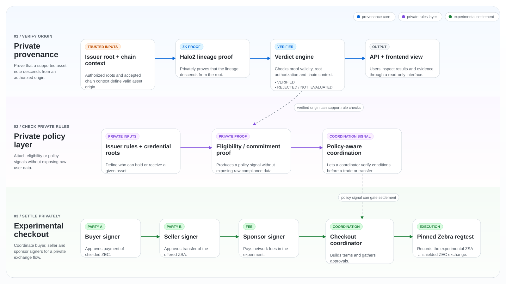

# ZWA Protocol

### Private assets. Verifiable origins.

Zero-knowledge asset provenance, private eligibility checks, and experimental
atomic shielded settlement of tokenized real-world assets on Zcash Shielded
Assets (ZSA).

**Website:** https://zwaprotocol.vercel.app/

> Everything here runs on **experimental** ZSA software (QEDIT and community
> forks implementing ZIP-227/ZIP-228). It is not Zcash mainnet functionality,
> not production ready, and all assets are test assets with no value.

## Overview

A tokenized real-world asset needs more than a balance: a buyer must know the
asset came from an authorized issuer, the issuer must know the buyer is
eligible, and the trade should settle without publishing either party's
holdings. ZWA works on three capabilities:

| Capability | Question | Approach |
|---|---|---|
| **Verify origin** | Does this note descend from an authorized issuance? | Halo2 per-step lineage proofs with authenticated root, terminal and chain context |
| **Check private rules** | Are this issuance and this recipient allowed for this exact trade? | Circom/Groth16 membership proofs, signed roots, `TradeCommitmentV1` |
| **Settle privately** | Can two parties swap a ZSA for shielded ZEC atomically? | Separately signed ZSA Action Groups assembled by a coordinator |

These were built and validated as separate workstreams. The full
provenance → eligibility → purchase pipeline is not yet one proof path; see
[Known limitations](#known-limitations).

## Architecture



- **Proof layer.** `lineage/` verifies frozen `NormalLineageStepV2` Halo2
  proofs (5,120 bytes per step) and joins them by public `cmx`/`nf` values
  (Design A). `circuits/` holds the Groth16 issuer-provenance and recipient-
  eligibility circuits.
- **Verification layer.** Verifier-owned keys and configuration, canonical
  evidence parsing, authenticated issuance root and terminal Action output,
  pinned chain view, and finality/checkpoint policy (Layer B). Verdicts fail
  closed: `VERIFIED`, `PENDING_FINALITY`, `CHECKPOINT_TRUST_REQUIRED`,
  `INVALIDATED_BY_REORG`, `REJECTED`.
- **Policy layer.** `crates/` defines canonical encodings, `TradeCommitmentV1`
  and credential structures; `checkout/authorization/` binds a Groth16
  authorization to the exact quote digest, AssetBase, receivers and amounts.
- **Settlement layer.** `exchange/` runs quotes, proof checks, a one-shot
  coordinator and wallet reconciliation. Buyer and seller each sign only
  their own Action Group; the website never holds keys.

More detail: [architecture](docs/architecture.md),
[trust model](docs/trust-model.md), [threat model](docs/threat-model.md),
[security claims](docs/security-claims.md).

## Implemented features

| Area | What exists | Where |
|---|---|---|
| Rooted lineage verifier | Halo2 Design A + Layer B verifier, local HTTP API with demo scenarios | [`lineage/`](lineage/README.md), [API](docs/phase3-api.md) |
| Private policy proofs | Issuer provenance and recipient eligibility circuits with receiver binding | [`circuits/`](circuits/README.md), [`crates/`](crates/) |
| Checkout authorization | Groth16 native-ZEC checkout circuit, proving and verification keys, adversarial tests | [`checkout/authorization/`](checkout/authorization/README.md) |
| Experimental exchange | Three test instruments (gold reference, Treasury-style, credit), order ledger with idempotent reservations, exact quotes, proof-gated settlement, receipts, restart durability | [`exchange/`](exchange/) |
| Buyer/seller wallets | Operator-provisioned accounts, one-time wallet pairing codes, wallet companions that approve in their own terminal | [runbook](docs/phase4e-c-runbook.md) |
| Hosted judge sandbox | Docker Compose stack: Caddy, web, portal, order service, restricted demo signer, pinned Zebra; per-wallet Landlock isolation; M9/M10 security review and recovery drill | [`deploy/`](deploy/README.md), [M9](docs/m9-hosted-demo-review.md), [M10](docs/m10-hosted-https-security-review.md) |
| Public ZSA tooling | Build-only issuance and transfer client, node-side byte check, private lab node, privacy-safe receipts | [`public-testnet/`](public-testnet/README.md) |
| Workload benchmark (not yet run on AWS) | Fail-closed harness for real regtest settlements in an isolated `zwa-bench-*` Compose project: 1 Hz host, cgroup and process sampling, automatic stop conditions, explicit levels 0–3 | [architecture](docs/benchmark-architecture.md), [runbook](docs/benchmark-runbook.md) |
| Website | Next.js public site and exchange UI | [`website/`](website/README.md) |

## Supported experimental networks

| Network | Used for | Not claimed |
|---|---|---|
| **Pinned Zebra regtest** (QEDIT ZSA swap branch, disposable local chains) | Atomic ZSA-for-shielded-ZEC settlement, the exchange, the judge sandbox | Persistence or finality of any past chain once its node stopped |
| **Community ZSA Testnet** (`zcash-shielded-assets/zebra`, lightwalletd `https://zsa.methyl.cc`) | One ZSA issuance and one shielded transfer | Any atomic swap. That network accepts one Action Group per transaction, so **no public-testnet atomic swap has been performed or proven** |
| Zcash mainnet | — | Not supported |

## Real settlement evidence

All regtest chains below were disposable and have since stopped. These are
recorded test transactions, not currently queryable ones.

**Human-approved regtest purchase (Phase 3.5H).** 7 ZSA units for 10,000
zatoshis, 5,000-zatoshi sponsor-paid network fee, both sides approved by hand
in separate terminals (owner-reported; per-role signer logs retained).
Txid `aaeb15b837d5b44fc6aaf6d88b36ac9b802cd53e6cd2cf292ef8450db6826dfd`,
block 103. Eligibility `NOT_EVALUATED`; purchased-note lineage `UNSUPPORTED`.
[Report](docs/checkout-phase35h-human-approval.md)

**Scripted multi-asset purchases (Phase 4D),** each behind the Groth16
checkout gate with independent test signers:

| Instrument | Trade | Txid |
|---|---|---|
| Gold reference | 7 units / 10,000 zat | `9287c3be6995d08896d1d8558b88081bb48d1fbb9f88528a00c6fc0679f855a2` |
| Treasury-style | 5 units / 12,500 zat | `58e342d0c717161cce299d2b8bcb6d798cce29d83311ebb39afec07e8238961d` |
| Credit participation | 3 units / 8,500 zat | `8140b4e68ef0e8b9487222de9acc892c602cea4196dec85df291a4ae07dac208` |

[Report](docs/phase4d-report.md) · [sanitized records](exchange/recorded-runs.json)

**Persistent-chain order (Phase 4E-B).** 1 gold unit for 1,000 zat (operator
test price), scripted approvals, txid
`0c9ad1ad369e6c72bf435329c67ef6693057b158857b5a8f0c7eca901056430c` at
height 1115; durable across two node restarts.
[Report](docs/phase4e-b-order-settlement-report.md)

**Judge sandbox (M9).** Three custodial demo purchases settled in blocks 216,
217 and 328 of an isolated Compose chain; 51/51 HTTP acceptance checks.
[Review](docs/m9-hosted-demo-review.md)

**Community ZSA Testnet (public).**

| Action | Txid | Block |
|---|---|---|
| Issuance of 1,000,000 units | `dfe0eed19c10cc0e6fad5f71227235ef5d08c232801a28e4a7ceafcbfc895340` | 202,121 |
| Shielded transfer | `9c0cfc6d475f165ce0b491b5b793c869b38e5af5a50fc6c7ecde58d711cf0e77` | 202,135 |

[Issuance](docs/public-zsa-testnet-phase3b-issuance-receipt.md) ·
[transfer](docs/public-zsa-testnet-phase3c-transfer-execution.md)

## Local development

Prerequisites: Rust (stable), Node.js 22, Python 3. The lineage workspace and
Circom tooling have their own pinned toolchains.

```sh
git clone https://github.com/Maheshsiddu29/ZWA-Protocol.git
cd ZWA-Protocol

# Website (public pages only; no backend needed)
cd website && npm ci && npm run build && ./node_modules/.bin/next start -p 3210
```

| Component | How to run |
|---|---|
| Lineage verifier API | `cd lineage`, then build `zwa-lineage-api` with a prepared offline `CARGO_HOME` ([API doc](docs/phase3-api.md)) |
| Recorded checkout evidence (read-only) | `python3 -m checkout.api --demo --port 18745` |
| Two-party local exchange | Five terminals: order service, website, seller and buyer wallet companions ([runbook](docs/phase4e-c-runbook.md)). Needs a pinned Zebra regtest node and a prepared exchange root. |
| Hosted judge sandbox | `deploy/compose.yaml` with `deploy/env-example/` copied to ignored `deploy/.env` and `deploy/env/` ([deploy guide](deploy/README.md)) |
| Public ZSA tooling | [`public-testnet/README.md`](public-testnet/README.md). Broadcasting requires explicit owner approval. |

Wallet homes, seeds, chain data and generated environment files live outside
the repository or in ignored paths. Never commit them.

## Tests

```sh
# Protocol core (also run by CI)
cargo fmt --check
cargo clippy --workspace --all-targets -- -D warnings
cargo test --workspace

# Circuit schema and adversarial tests
npm ci && npm test

# Checkout and exchange (unit tests; no chain needed)
python3 -m unittest checkout.test_checkout exchange.test_demo exchange.test_deploy \
  exchange.test_exchange exchange.test_order_ledger exchange.test_persistent_chain \
  exchange.test_phase4e_c exchange.test_wallet_companion_tty exchange.test_zebra_provenance \
  exchange.test_provenance_stage

# Benchmark harness (no Docker or chain; one disposable /private/tmp/zwa4e-test-* root)
python3 -m unittest benchmark.test_safety benchmark.test_metrics benchmark.test_workload \
  benchmark.test_cli benchmark.test_integration

# Lineage verifier (needs a prepared offline cargo cache)
lineage/scripts/check.sh

# Website
cd website && npm ci && npm run lint && npm run build
```

`checkout/authorization/test_*.js` and `tests/acceptance/` exercise a live
disposable chain or Compose stack and are run from their runbooks. The Phase 2
differential suite (`lineage/scripts/check-research.sh`) needs the separate
research checkout; its record reports 236 classified cases with zero
unexplained divergences.

## Known limitations

- **Experimental only.** No production or mainnet readiness is claimed.
  Cryptographic review and production custody/security engineering have not
  been done.
- **Separate proofs.** The settled notes were not shown to satisfy the
  rooted-lineage relation, and eligibility was not evaluated in the Phase 3.5H
  purchase. The lineage relation covers one non-split, nonzero-value, non-native
  ZSA step class, not arbitrary ownership or value history, and it is
  per-step verification with public joins, not recursion over a hidden path.
- **Application-level policy.** ZWA rules are enforced by the matcher and
  exchange, not by Zcash consensus. Arbitrary external ZSA transfers are not
  blocked.
- **Authorization semantics.** On the tested branch, Action Group signatures do
  not cover every outer-transaction field and group expiry was not
  consensus-enforced, so settlement uses one-shot approvals, not standing
  orders.
- **Exchange status.** Phase 4E-C completed a browser-initiated purchase in
  scripted test mode; a human-approved run on that path is not recorded.
  Prices are operator-set test prices, not oracle-executable quotes.
- **Public site.** The Vercel site serves public pages only. The exchange,
  demo wallets and live verification need the separate backend.
- **No public-testnet atomic swap** (see networks above).

## License and acknowledgments

No ZWA Protocol project license has been selected yet. Until one is, no
license is granted for ZWA's own code.

Third-party and pre-existing work keeps its own license and attribution:

- **PRE-EXISTING ZK-ORIGIN:** primitives and design from
  [ZKChainForge/zk-origin](https://github.com/ZKChainForge/zk-origin) at
  `eae3f3e19dd63562364149ecb000f2de7296d025`, MIT
  ([license](circuits/shared/zk-origin/LICENSE)).
- **Orchard / R2B-L1 vendored source:** MIT or Apache-2.0
  ([licenses](lineage/vendor/r2b-l1/orchard-licenses/)).
- **Community ZSA tooling:** Zkool `rlz` (MIT), `zcash-shielded-assets/zebra`
  (MIT/Apache-2.0), `zcash-shielded-assets/lightwalletd` (MIT).
- **QEDIT** experimental ZSA Zebra and transaction tooling.
- Website fonts and assets: [notices](website/THIRD_PARTY_NOTICES.md).

Everything else in this repository is **NEW ZWA PROTOCOL WORK**.
